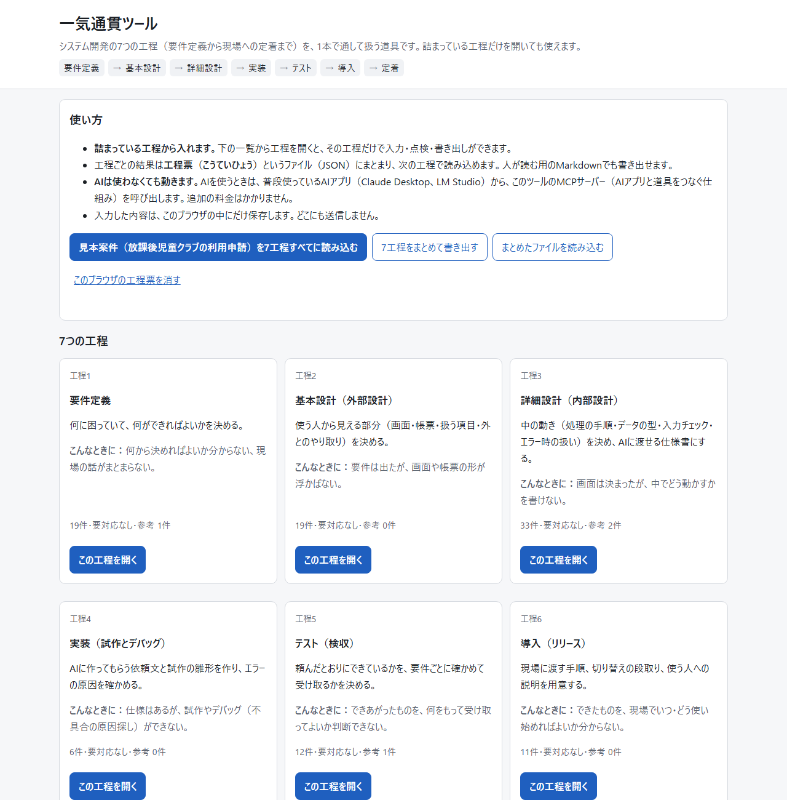
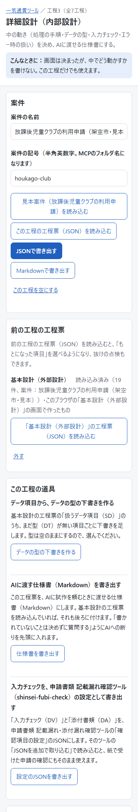

# 一気通貫ツール（ittsukan-tool）

公開URL：https://takashi-101.github.io/ittsukan-tool/ 　「見本案件を7工程すべてに読み込む」を押すと、入力しなくても使い方を確かめられます。

## 概要（30秒で読めます）

システム開発の7つの工程（要件定義・基本設計・詳細設計・実装・テスト・導入・定着）を、1本で通して扱う道具です。**詰まっている工程だけを開いても使えます。**

| この工程で詰まっている会社向け | できること |
|---|---|
| **要件定義**：何から決めればよいか分からない、現場の話がまとまらない | 現状の業務 → 困りごと → 目的 → 必要な機能 の順に書き出し、つながっていない困りごとや、機能の無い目的を知らせる。業務棚卸し（gyomu-tanaoroshi）のJSONから現状の業務を読み込める |
| **基本設計**：要件は出たが、画面や帳票の形が浮かばない | 必要な機能から画面の下書きを作り、書いた項目から画面・帳票の形（入力の形・一覧の形・1枚の書類の形）を描いて印刷する。項目から扱うデータ項目を拾い出し、機能と画面・帳票の対応表で、どこにも出てこない必須の機能を知らせる |
| **詳細設計**：画面は決まったが、中でどう動かすかを書けない | 処理の手順・データの型・入力チェック・エラー時の扱いを書き、AIに渡せる仕様書（Markdown）にする。入力チェックは申請書類の確認ツール（shinsei-fubi-check）の設定として書き出せる |
| **実装**：仕様はあるが、試作やデバッグ（不具合の原因探し）ができない | AIへの実装依頼文の下書き、画面の形と入力チェックだけの試作の雛形（1ファイルのHTML）を作る。エラーの文章から原因の候補と確かめ方を出す |
| **テスト**：できあがったものを、何をもって受け取ってよいか判断できない | 要件ごとの確認項目を作り、AIへの依頼と出力の食い違い（落とした・足した・選んだ・寄せた）に印を付け、採る・採らないと検収の判断を残す |
| **導入**：できたものを、現場でいつ・どう使い始めればよいか分からない | 現場へ渡す手順、切り替えの段取り（並行して使う期間と元に戻す方法）、使う人向けの説明（A4で印刷）、よくある問い合わせを用意する |
| **定着**：使い始めたが、担当が替わると回らなくなりそう | 手順書と判断の分かれ目を残し、業務棚卸し・事務引継ぎ記録（gyomu-tanaoroshi）にそのまま取り込める形で書き出す |

- 工程ごとの結果は **工程票（こうていひょう）** というJSONにまとまり、次の工程で読み込めます。人が読む用のMarkdownでも書き出せます。
- **追加の料金はかかりません。** 有料のAPI（使った分だけ料金がかかる仕組み）は使いません。AIを使うときは、普段使っているAIアプリ（Claude Desktop、LM Studio）から、このツールのMCPサーバー（AIアプリと道具をつなぐ共通の仕組みの、道具側）を呼び出します。
- **AIを使わなくても、画面での入力・点検・書き出しはすべて動きます。** 点検はAIを使わず、決まりで行います。
- 入力した内容は、ブラウザの中（またはPCの案件フォルダ）にだけ置きます。どこにも送信しません。

## 使う人

| 使う人 | 使い方 |
|---|---|
| 行政・大学・中小企業の発注担当者（エンジニアではない人） | 詰まっている工程の画面を開き、欄を埋めて点検の結果を見る。工程票を書き出して、開発する人や次の工程に渡す |
| 現場に入って支援する人（FDE） | 7工程を通して使い、通しの点検で抜けを確かめる。AIアプリからMCPで工程票を読み書きし、聞き取りや下書きを速くする |

## 画面

PCで7工程の一覧と通しの点検を見たところ



スマートフォンで詳細設計の工程を見たところ（選考の決まりに「架空の基準」の印）



## 7工程の入力と出力

| 工程 | 前の工程の工程票 | 書くもの（番号の頭文字） | 書き出すもの |
|---|---|---|---|
| 1 要件定義 | なし | 現状の業務（W）、困りごと（P）、目的（G）、必要な機能（R）、対象外にすること（X） | `01-yoken.json` |
| 2 基本設計（外部設計） | 要件定義 | 画面（SG）、帳票（SC）、扱うデータ項目（SD）、外部とのやり取り（SX） | `02-kihon-sekkei.json` |
| 3 詳細設計（内部設計） | 基本設計 | 処理の手順（DP）、データの型（DT）、入力チェック（DV）、添付書類（DA）、判定の決まり（DR）、エラー時の扱い（DE） | `03-shosai-sekkei.json`、AIに渡す仕様書、shinsei-fubi-check の設定 |
| 4 実装（試作とデバッグ） | 詳細設計 | AIへの実装依頼文（IP）、試作の雛形（IS）、エラーの原因候補と確かめ方（IE） | `04-jisso.json`、試作の雛形（HTML） |
| 5 テスト（検収） | 要件定義、実装 | 要件ごとの確認項目（TC）、依頼と出力（TR）、食い違いの印（TM）、検収の判断（TA） | `05-test.json`、ai-decision-audit の形の記録 |
| 6 導入（リリース） | 要件定義、テスト | 現場へ渡す手順（LS）、切り替えの段取り（LC）、使う人向けの説明（LE）、よくある問い合わせ（LQ） | `06-donyu.json`、説明の印刷、madoguchi-kaito の台帳 |
| 7 定着（運用・引継ぎ） | 導入 | 手順書（MP）、判断の分かれ目と引継ぎ（MH）、見直しの時期（MR） | `07-teichaku.json`、gyomu-tanaoroshi の形のJSON |

どの工程にも **未決事項（Q）** を書けます。各工程の欄の説明は、`stages/` の中の各フォルダの README にあります。

### 工程票の形

```json
{
  "kind": "kouteihyo", "stage": "yoken", "schema_version": "1",
  "case": { "id": "houkago-club", "name": "放課後児童クラブの利用申請（架空市・見本）" },
  "updated": "2026-11-05T00:00:00Z",
  "upstream": [],
  "items": [ { "id": "R-01", "section": "kino", "title": "Webの申込の画面", "priority": "必須", "from": ["G-02"] } ],
  "open_questions": [ { "id": "Q-01", "text": "Webの受付期間を、窓口と同じ期間にするか", "status": "未決" } ]
}
```

- `from` に、その項目のもとになった前の工程の項目の番号を書きます。要件定義の機能（R）から、画面（SG）・処理（DP）・依頼文（IP）・確認項目（TC）・導入の手順（LS）・手順書（MP）までたどれます。
- 欄の定義は `common/schema.json` の1か所にあり、画面・点検・MCPサーバーのどれもここから作ります。

### 点検（AIは使わない）

- 必須の欄の空き
- 「もとになった項目」の番号が、前の工程の工程票につながるか
- 前の工程の項目の抜け（例：確認項目の無い必須の機能、処理の手順が一つも無い画面）
- 結果が不合格・未実施の確認項目、採る・採らないが未選択の印
- 「架空の基準」と書いた決まり（本番の前に、実在の基準へ置き換える）
- 未決事項

入口の画面の「通しの点検」で、7工程をまとめて点検できます。

## 既存のツールとのつなぎ口

既存の5本は取り込まず、それぞれのJSONの形で読み書きできるようにしています。

| 既存のツール | 扱い | つなぐ工程と形 |
|---|---|---|
| [gyomu-tanaoroshi](https://github.com/takashi-101/gyomu-tanaoroshi)（業務棚卸し・事務引継ぎ記録） | 参照のみ | 要件定義：書き出したJSONを「現状の業務」として読み込む（月の作業時間は同じ換算）。定着：手順書と判断の分かれ目を、業務と事務引継ぎ記録のJSONとして書き出す（「JSONを追加で取り込む」で足せる。重ねて取り込んでも重ならない） |
| [shinsei-fubi-check](https://github.com/takashi-101/shinsei-fubi-check)（申請書類の記載漏れ・添付漏れ確認） | 参照のみ | 詳細設計：入力チェックと条件付きの添付書類を、「確認項目の設定」のJSONとして書き出す |
| [ai-decision-audit](https://github.com/takashi-101/ai-decision-audit)（AIが決めたことチェック） | 参照のみ | テスト：同じ4種類の印と判定の依頼文を使う。依頼と出力・印を同じ形の記録（JSON）として書き出す。書き出したファイルは、ai-decision-audit の「AIアプリの返答」の欄に貼ると印として読める（採る・採らないは引き継がない） |
| [madoguchi-kaito](https://github.com/takashi-101/madoguchi-kaito)（窓口・庁内問い合わせ 回答標準化） | 参照のみ | 導入：よくある問い合わせを、標準回答台帳のJSONとして書き出す（「JSONを追加で取り込む」で足せる） |
| [readonly-mcp](https://github.com/takashi-101/readonly-mcp)（読み取り専用のMCPサーバー） | 作り方だけ取り込む | Pythonの標準機能だけ・標準入出力だけ・読み書きの記録を残す、という作り方を同じにした（コードは別） |

## AIアプリから使う（MCPサーバー）

`mcp/ittsukan_mcp.py` は、工程票の読み込み・書き出し・点検を、AIアプリの道具として出すMCPサーバーです。

- Pythonの標準機能だけで動きます。追加のインストールは要りません。
- 通信は標準入出力（同じPCの中でのやり取り）だけです。外部には通信しません。
- 読み書きするのは案件フォルダ（既定はこのリポジトリの `cases/`）の中だけです。案件ごとにフォルダができ、工程票を `01-yoken.json` と `01-yoken.md` のように保存します。上書きの前に `backup/` に控えを残します。
- 道具が返す文章は、1回1,200字までに区切ります（手元のモデルは扱える文章量が小さいため）。続きは `cursor` で読みます。
- 読み書きの記録（いつ・どの道具で・どの案件のどの工程か。中身は記録しない）を `mcp/logs/access_log.jsonl` に残します。

| 道具 | 内容 |
|---|---|
| `list_cases` | 案件の一覧と、7工程それぞれの工程票の有無・件数 |
| `get_overview` | 1つの工程票のあらまし（欄ごとの件数と番号、未決事項、点検の件数） |
| `read_items` | 項目を区切って返す。`section` で欄を絞り、`item_id` で1件を全文で読む |
| `get_guide` | その工程で聞くこと・埋める欄の手引き。`section` を付けると欄の項目と書き方の例 |
| `write_items` | 項目を足す・直す・消す。番号は自動で振る。1件でも誤りがあれば何も書き込まない |
| `check_sheet` | 決まりによる点検（画面の点検と同じ結果） |
| `record_mark` | テストの工程票に、依頼と出力の食い違いの印を記録する（引用が依頼文・出力に無ければ断る） |

画面で書き出した工程票（JSON）を案件フォルダに置けば、MCPサーバーからも読めます。MCPサーバーで書いた工程票は、画面の「この工程の工程票（JSON）を読み込む」で開けます。

### 見本案件を案件フォルダに置く

```bash
python mcp/ittsukan_mcp.py --init-sample
```

### Claude Desktop（Windows）

1. このリポジトリを `C:\Users\<ユーザー名>\work\ittsukan-tool` に置きます。
2. `%APPDATA%\Claude\claude_desktop_config.json` に、`mcp/claude_desktop_config.example.json` の内容を書き足し、`<ユーザー名>` を自分のものに直します。
3. Claude Desktop を再起動します。

### LM Studio（0.3.17以降）

1. LM Studio で、道具の呼び出し（tool use）に対応したモデルを入れます（下の「確認したモデル」を参照）。
2. 「Program」の画面の「Install」→「Edit mcp.json」を開き（ファイルの場所は `%USERPROFILE%\.lmstudio\mcp.json`）、`mcp/lmstudio_mcp.example.json` の内容を書き足して、`<ユーザー名>` を直します。
3. チャットの画面で、モデルを選んで使います。

Windowsで `python` と打つと、Pythonではなく Microsoft Store の案内が開く場合は、「設定」→「アプリ」→「アプリの詳細設定」→「アプリ実行エイリアス」で「アプリ インストーラー python.exe」をオフにするか、設定の `"command"` にインストールしたPythonの場所をそのまま書きます（JSONの中では `\` を `\\` と2つ重ねて書きます）。

### 確認したモデル

`python mcp/test_client.py --lmstudio モデル名` で、LM Studio のモデルに道具を使う課題（点検して件数を答える、項目を1件書き込む、区切られた項目を読んで答える）を解かせ、結果と使ったモデル名を [mcp/model-check.md](mcp/model-check.md) に記録しています。このスクリプトがAIアプリの代わりになり、モデルが選んだ道具をMCPサーバーで実行します。

## 見本案件：放課後児童クラブの利用申請

架空の市で、紙と窓口で受け付けている放課後児童クラブの利用申請を、一部Web申込に置き換える案件です。要件定義から定着まで、7工程の工程票がつながっています（`samples/houkago-club/`）。

- 市・クラブ・数字は、すべて架空のものです。
- **選考の点数と同点のときの順番の決まりは「架空の基準」です。** 実在の自治体の基準ではありません。画面ではその項目に「架空の基準」の印と断り書きを出し、工程票（JSONとMarkdown）にも明記しています。本番で使う前に、実在の基準（例規・要綱など）に置き換えてください。
- 見本の工程票は `python tools/build_sample.py` で作り直せます。

## 動かし方

- **公開URLで使う**：上の公開URLを開きます。入力した内容はそのブラウザの中にだけ保存します。
- **ファイルを開くだけで使う**：このリポジトリ一式を取得し（GitHubの「Code」→「Download ZIP」）、`index.html` をブラウザで開きます。インストールもビルドも要りません。ネットにつながらないPCでも動きます。
- **1つの工程だけを使う**：`stages/` の中の工程のフォルダ（例：`stages/03-shosai-sekkei/`）だけを取り出して、その中の `index.html` を開きます。フォルダの中に必要な部品がすべて入っています。

## 動作の確かめ方（管理する人向け）

```bash
python test/run_tests.py
```

画面のテスト（Chrome か Edge を画面なしで起動）。7工程の画面、項目の追加・直し・削除、つなぎ口、通しの点検、375pxと1280pxで横にはみ出さないこと、どこにも通信しないこと、JavaScript版とPython版の点検・Markdownの結果が同じであることを確かめます。

```bash
python mcp/test_client.py
```

MCPサーバーのテスト（初期化、7つの道具、区切り、書き込みの誤りの扱い、案件フォルダの外を読み書きしないこと、記録）。

推奨モデルは qwen3.5-4b。llama-3.2-3b は書き込みと読み取りの課題に失敗するため推奨しない（記録は [mcp/model-check.md](mcp/model-check.md)）。

```bash
python tools/sync_common.py --check
```

各工程のフォルダに配った共通の部品が、`common/` の元と同じかを確かめます。`common/` を直したら `python tools/sync_common.py` で配り直します。

画面写真は `python test/run_tests.py --shots` で撮れます（375px と 1280px、ライト／ダーク。`test/screenshots/`）。

## フォルダの構成

| フォルダ・ファイル | 中身 |
|---|---|
| `index.html` | 入口（7工程の一覧、通しの点検、まとめての読み書き） |
| `common/` | 共通の部品（工程票の定義 `schema.json`、点検とMarkdown `core.js`、画面 `ui.js`、つなぎ口 `adapters.js`、見た目 `style.css`、見本 `samples.js`） |
| `stages/NN-xxx/` | 工程ごとの画面（`index.html`、その工程の道具 `stage.js`、README、共通の部品の複製） |
| `mcp/` | MCPサーバー（`ittsukan_mcp.py`、点検とMarkdownのPython版 `ittsukan_core.py`）、テスト（`test_client.py`）、設定の例、モデルでの確認の記録 |
| `samples/houkago-club/` | 見本案件の工程票7枚（JSONとMarkdown）と、業務棚卸しの形の入力ファイル |
| `tools/` | 見本を作る `build_sample.py`、共通の部品を配る `sync_common.py` |
| `test/` | 画面のテスト |

## 限界

- 点検は決まり（必須の欄、番号のつながり、抜け）で行います。中身が正しいか、足りているかは人が判断します。
- 基本設計の形の下書きは、項目の名前と種類から決まりで描きます。配置や見た目のデザインを決めるものではありません。個人情報に当たるかの印は候補で、決めるのは人です。
- 試作の雛形は、画面の形と入力チェックだけです。受付簿への保存や選考の計算は入っていません。
- エラーの原因候補は、よくあるエラーの表から引きます。表に無いエラーは、AIアプリに聞いてください。
- 画面の工程票はブラウザごとに保存します。別のPCやブラウザで続けるときは、JSONで書き出して読み込みます。
- 業務棚卸しの形で書き出した手順書には、作業時間が入りません（業務棚卸しのツールで入れてください）。

## 根拠（学習）

| 機能 | 裏付けになる学習（発行元・名称・発行日） | 照会先（Credly） |
|---|---|---|
| 要件定義：現状の業務 → 困りごと → 目的 → 必要な機能 の順に書き出す | IBM SkillsBuild「Enterprise Design Thinking Practitioner」2026年2月4日 | https://www.credly.com/badges/e48a9c98-f7f7-4354-8520-f74492b3754b |
| 実装：AIへの実装依頼文の下書き | Coursera「Google Prompting Essentials」2026年10月13日 | https://www.credly.com/badges/c5305332-c47b-480d-85e0-678a72908a79 |
| どこにも通信しない作り（全工程） | Amazon Web Services Training and Certification「AWS Knowledge: Security Champion - Training Badge」2025年11月10日 | https://www.credly.com/badges/ddab077d-58eb-4807-bec1-69e5c6aeb9a5 |
| AIアプリから使う（MCPサーバー） | Coursera（認定：IBM）「Build AI Agents Using MCP」2026年11月3日 | https://www.credly.com/badges/eb0ddb53-3a26-48ba-95d6-cbc242ed24bc |

## ライセンス

MIT
